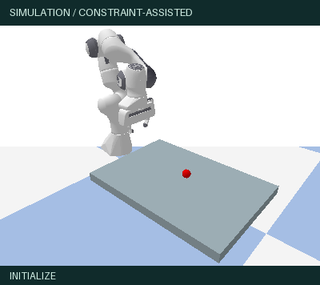
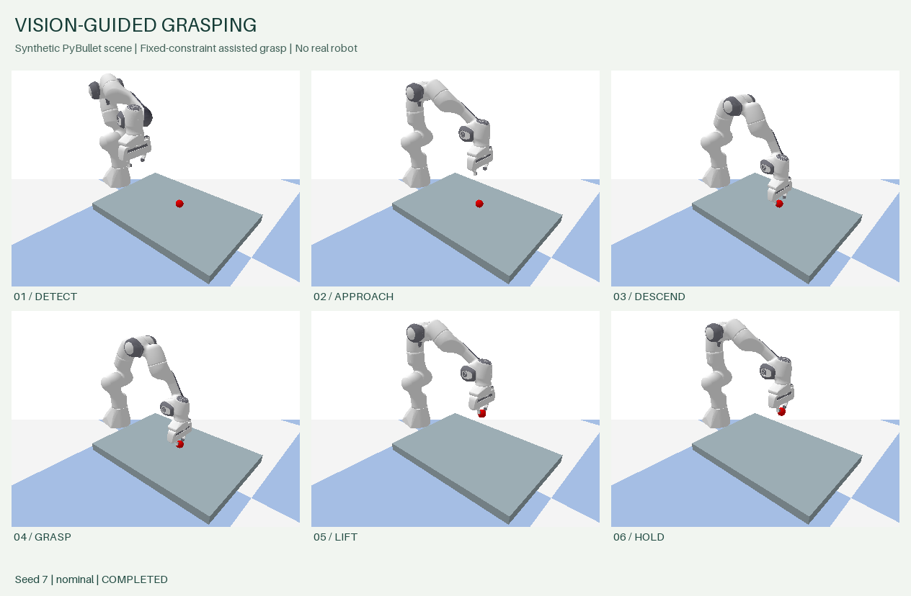

# Vision-Guided Grasping Demo

[](https://github.com/jia1974346649-beep/vision-guided-grasping-demo/actions/workflows/demo.yml)

一个可复现的视觉引导机器人抓取作品集：从仿真 RGB-D 图像定位红色球体，驱动 Panda 机械臂完成接近、闭合与抬升，并自动生成运行报告。

这是作者与 AI 协作完成的**独立匿名重建演示**。它将既有机器人探索经验整理成可安装、可运行、可检查的工程示例，使用合成场景与新生成的实验结果。

> **演示范围：**默认使用 PyBullet `DIRECT` 与 TinyRenderer，无需 GPU。夹持后使用固定约束辅助物体随夹爪运动，报告标注为 `constraint-assisted`；抬升结果用于验证感知、控制与状态机的整合，不能据此推断真实接触摩擦抓取性能。





先看上面的动图和阶段图即可了解演示，无需安装。需要复现时，推荐下方 Linux / WSL2 路线。

## 可以看到什么

| 环节 | 本仓库的实现 | 可检查的证据 |
| --- | --- | --- |
| 视觉定位 | RGB 转 HSV、红色区域分割、深度反投影；顶置相机结合已知球半径估计球心 | 图像检测结果、估计坐标与定位误差 |
| 机械臂控制 | Panda 内置 IK 生成朝下初始化参考，自行实现的六维阻尼最小二乘细化与 PID 关节速度控制 | 轨迹 CSV、阶段记录与仿真动画 |
| 流程编排 | 有限状态机组织检测、接近、闭合、辅助夹持与抬升 | 阶段事件、最终状态与失败原因 |
| 实验交付 | 固定随机种子、明确失败场景、自动生成报告 | JSON、HTML、CSV、GIF 与 PNG |

## 安装与运行

推荐 **Linux x86-64 / Windows WSL2，Python 3.10 或 3.11**，以及 Git 和首次安装依赖时的网络连接。代码兼容目标为 Python 3.9–3.12；实际运行环境见[验证记录](docs/verification.md)。运行时使用本地仿真，不需要账号、密钥、相机或机器人硬件。

依赖固定为 `numpy==1.26.4`、`pybullet==3.2.7`、`Pillow==11.3.0`。机器人 URDF 和网格从安装的 `pybullet_data` 读取，无需另行下载模型。

### Linux / WSL2 中运行

以下命令假定系统已安装 Python 3.11、对应的 venv 模块和 Git。直接使用虚拟环境解释器，无需激活环境。

```bash
git clone https://github.com/jia1974346649-beep/vision-guided-grasping-demo.git
cd vision-guided-grasping-demo
python3.11 -m venv .venv
.venv/bin/python -m pip install --only-binary=:all: -r requirements.txt
.venv/bin/python -m grasp_demo --seed 7 --case nominal --output runs/demo
```

如果使用已安装的 Python 3.9 或 3.10，将创建环境的命令对应替换为 `python3.9` 或 `python3.10`。Ubuntu / Debian 的系统 Python 若缺少 venv，请先安装对应版本的 venv 包。

`--only-binary=:all:` 让缺少预编译包的环境直接给出明确错误，避免意外进行耗时的源码编译。PyBullet 3.2.7 的官方发布文件中有 Linux x86-64 的 CPython 3.9 / 3.10 / 3.11 wheel，没有 Windows、macOS 或 CPython 3.12 wheel；这些环境通常需要自行配置编译工具链。[官方 PyPI 文件列表](https://pypi.org/project/pybullet/3.2.7/#files)

### Windows 用户：从 PowerShell 进入 WSL2

已安装 WSL2 的用户，可先列出自己的发行版名称，再进入它的 Linux 终端：

```powershell
wsl --list --verbose
wsl -d Ubuntu
```

`Ubuntu` 是示例名称，替换为列表中自己已安装的发行版；在 WSL2 内执行上一节的 Linux 命令。首次安装 WSL2 或系统依赖需要按自己的系统配置完成，仓库不会自动修改系统。

运行完成后，在仓库目录中执行 `explorer.exe .`，可用 Windows 文件管理器打开 `runs/demo/report.html`。原生 Linux 可直接用浏览器打开该文件。

Windows 原生安装需要匹配的 C++ Build Tools 等编译环境，当前没有验证这条路线；macOS 也未实测。希望直接复现时，优先使用上述 Linux / WSL2 环境。

## 运行结果

每次运行输出到 `--output` 指定的目录：

| 文件 | 用途 |
| --- | --- |
| `report.html` | 离线查看动画、阶段、指标与失败说明 |
| `report.json` | 机器可读结果，含种子、场景、夹持模式、定位误差与软件版本 |
| `trajectory.csv` | 检查时间序列与控制轨迹 |
| `preview.gif` | 查看本次真实仿真生成的动画 |
| `overview.png` | 对比运行阶段与结果 |

`success` 表示当前演示判定条件达成，需同时阅读 `grasp_mode` 与报告中的约束辅助说明。运动目标来自视觉估计；仿真真实坐标用于误差评估，以及显式辅助夹持约束的距离检查和相对位姿建立。

已生成的 [seed 7 指标](examples/seed-7/report.json)、[轨迹](examples/seed-7/trajectory.csv)及[离线报告 HTML](examples/seed-7/report.html)可用于对照；HTML 下载或克隆后用浏览器打开，GitHub 文件页显示其源码。同一输出目录再次运行会替换上述五个结果文件。

## 复现失败场景

```bash
.venv/bin/python -m grasp_demo --seed 7 --case no-target --output runs/no-target
.venv/bin/python -m grasp_demo --seed 7 --case out-of-workspace --output runs/out-of-workspace
```

`no-target` 用于观察检测失败，`out-of-workspace` 用于观察工作空间检查。失败同样生成报告，便于区分感知、可达性与控制问题。完整步骤见[演示使用指南](docs/demo-guide.md)。

## 验证与技术说明

```bash
.venv/bin/python -m unittest discover -s tests -v
```

[验证记录](docs/verification.md)列出本次发布的实际运行环境、测试范围和结果。单次成功或少量固定种子运行不代表泛化成功率。

复现 [5 个固定种子与 2 个预期失败场景的记录](examples/regression.json)：

```bash
.venv/bin/python scripts/run_regression.py --output runs/regression.json
```

[GitHub Actions](https://github.com/jia1974346649-beep/vision-guided-grasping-demo/actions/workflows/demo.yml) 配置为在 Linux / Python 3.11 中安装固定依赖、运行测试，并生成正常与两个失败场景的报告。以工作流页面显示的实际状态为准；日志只包含公开合成场景的数据。

- [架构与算法边界](docs/architecture.md)：相机反投影、控制链与状态机。
- [作者与 AI 协作分工](docs/contribution.md)：产品判断、实现过程与可展示能力。
- [第三方来源与许可](NOTICE.md)：PyBullet、Panda 模型及本仓库代码的归属。

## 作品集定位

这个项目展示作者将需求拆解为可运行闭环的能力：把感知、控制、状态管理与实验记录连接起来，保留失败证据，并交付可复现的安装与演示流程。代码、测试和文档在 AI 辅助下实现；贡献说明以实际分工为准。

当前公开范围是受控仿真中的经典视觉与控制基线。强化学习训练、实机部署以及真实摩擦抓取属于后续可扩展方向，不计入当前完成成果。

本仓库新编写的演示代码采用 [MIT 许可](LICENSE)。第三方机器人模型与依赖遵循各自许可，详见 [NOTICE](NOTICE.md)。
