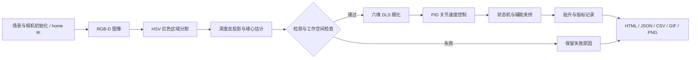

# 架构与算法

该演示围绕一个桌面红色球体构建最小闭环。场景、相机和机器人在本地 PyBullet 中运行；报告从本次运行的数据生成。

## 视觉定位

相机输出彩色图像和深度缓冲。检测器将 RGB 转换为 HSV，用红色色相区间和饱和度条件生成掩码，选取最大红色连通区域及其质心；通用检测函数使用该区域的有效深度中位数返回表面估计。仿真中的球心估计则在检测质心附近另取 3 × 3 深度中位数，以匹配球体顶点的几何假设。没有足够有效像素时，流程停止并记录检测失败。

反投影使用与渲染一致的 view / projection 矩阵。像素坐标与深度缓冲映射到标准化设备坐标后，通过投影矩阵与视图矩阵的逆变换还原世界坐标；矩阵按 PyBullet 的列主序约定处理。

反投影得到可见表面点。演示固定为顶置相机和已知半径球体，再沿竖直方向补偿球半径得到球心估计。这一几何假设适合当前受控场景，不能直接推广到任意视角、物体形状或遮挡情况。

机械臂运动目标来自视觉估计。仿真真实坐标用于计算定位误差和最终结果，也用于辅助夹持前的距离检查，以及固定约束的相对位姿建立；这一辅助机制单独标注在报告中。

## 运动与控制

Panda 内置 IK 用于生成末端朝下姿态的初始化参考；后续接近、下降和抬升目标使用自行实现的六维阻尼最小二乘（DLS）步骤求解位姿。DLS 在雅可比映射中加入阻尼，并限制单步更新幅度，降低奇异姿态附近过大的数值更新。这是匿名重建版本的局部逆解实现。

关节 PID 根据目标与当前关节位置误差生成速度指令，包含输出限制与状态重置，并以 240 Hz 物理步长推进执行。状态机分别处理接近、下降、闭合、抬升等阶段。DLS 临时计算正向运动学时会恢复原有关节位置与速度；实际动作通过物理步进执行。

这里的“闭环”指每个仿真步读取关节状态再更新控制量。目标定位在检测阶段完成，当前演示没有实现连续视觉伺服、通用避障、轨迹优化或移动目标跟踪。

## 辅助夹持及成功判定

默认夹持模式为 `constraint-assisted`：接近目标并闭指 0.5 秒后，在距离检查通过的条件下建立保持当前相对位姿的固定约束，物体随夹爪抬升，不通过重置目标位置来制造抬升效果。该机制使端到端集成过程容易复现，但不验证由接触力、摩擦与夹爪几何自然形成的稳定抓取。

抬升后继续保持 0.5 秒，保持期间的真实球体抬升高度均超过 0.12 米才满足成功条件。结果记录抬升高度、最终状态与失败原因。阅读 `success` 时必须保留 `grasp_mode` 条件；它是当前受控演示的判定结果。

## 失败与可复现性

- `nominal`：目标位于预设工作区域，执行完整流程。
- `no-target`：没有有效红色目标，验证检测失败能被记录。
- `out-of-workspace`：目标超出预设工作范围，验证动作前的边界检查。

固定随机种子控制场景扰动。物理步长、阶段事件、软件版本及估计坐标写入报告；不同依赖、平台与浮点环境仍可能产生细微差异。报告中的仿真时长与程序实际耗时是不同指标。

仿真连接通过 `DIRECT` 建立，由代码在结束时清理。TinyRenderer 负责离屏图像，不要求显示窗口或独立 GPU。程序仅访问本地安装的资源与指定输出目录。

## 第三方基础

物理引擎、Panda URDF 和网格由 PyBullet 及 `pybullet_data` 提供；它们不属于作者自行制作的模型。来源和许可见 [NOTICE](../NOTICE.md)。
